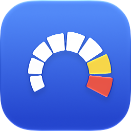
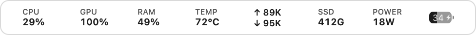
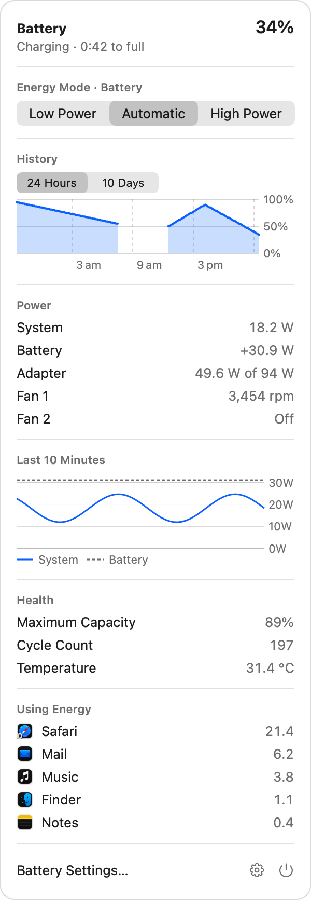
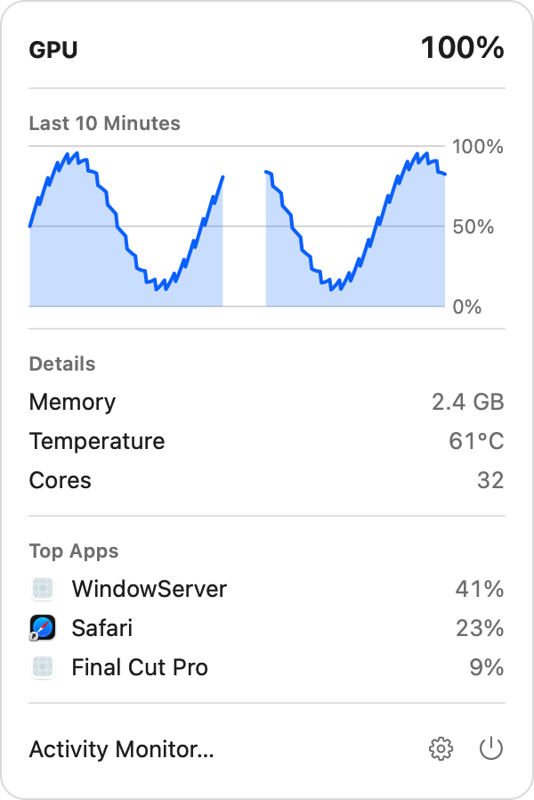
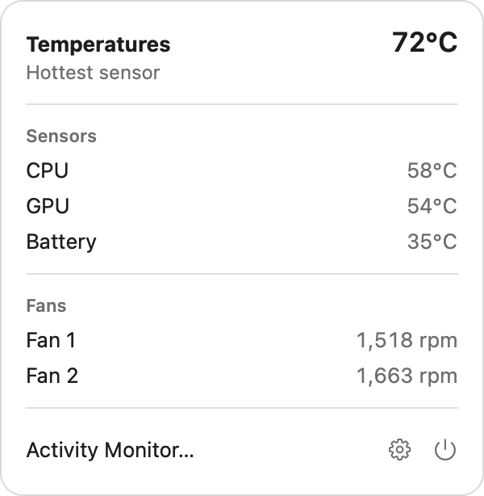

  <picture>
    <source media="(prefers-color-scheme: dark)" srcset=".github/readme/icon-dark.png">
    
  </picture>

<h1 align="center">Boost Gauge</h1>

Your Mac's battery, CPU, GPU, memory, temps and network, right in the menu bar.

<h3 align="center"><a href="../../releases/latest">Download for Mac</a></h3>

  <picture>
    <source media="(prefers-color-scheme: dark)" srcset=".github/readme/menubar-dark.png">
    
  </picture>

  <picture><source media="(prefers-color-scheme: dark)" srcset=".github/readme/battery-dark.png"></picture>
  <picture><source media="(prefers-color-scheme: dark)" srcset=".github/readme/gpu-dark.png"></picture>
  <picture><source media="(prefers-color-scheme: dark)" srcset=".github/readme/temps-dark.png"></picture>

## What you get

- One menu bar item per stat
- Show, hide and drag to reorder
- Click any stat for details
- Battery health and history
- Switch Energy Mode in one click
- Temps and fan speeds
- Top apps by CPU, GPU and memory

## Install

Needs macOS 27 on Apple Silicon. Open the DMG and drag Boost Gauge to Applications.

If you use Energy Mode, allow the Boost Gauge helper once in System Settings > General > Login Items & Extensions.

## Credits

Temperature and fan code adapted from [Stats](https://github.com/exelban/stats) (MIT); see [THIRD_PARTY_NOTICES.md](THIRD_PARTY_NOTICES.md). Boost Gauge is [MIT licensed](LICENSE).

Want to build it yourself? See [BUILDING.md](BUILDING.md).
